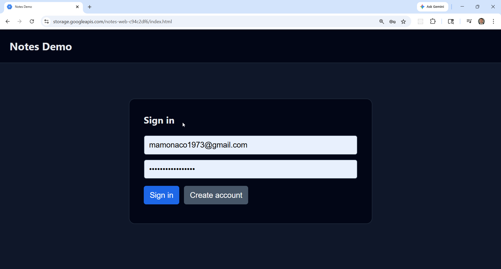

# Photo-to-Cartoon on GCP: Identity Platform, API Gateway, Pub/Sub and Imagen

A serverless **photo-to-cartoon** app. Users sign in with **Identity
Platform** (Firebase Auth), upload a photo straight to **Cloud Storage**,
and pick one of six styles. An **API Gateway** checks the Firebase token and
forwards to a **Cloud Function** that queues the job on **Pub/Sub**. An
event-triggered worker function sends the photo to **Vertex AI Imagen**'s
image editing and stores the cartoon. Job state lives in **Firestore**. The
single-page web app polls for the result and keeps each user's history.



| Piece | Where | Role |
|---|---|---|
| **Identity Platform** | project | email and password sign-in, turned on by `api_setup.sh`; the web app uses an API key restricted to the Identity Toolkit API |
| **cartoonify-gateway** | API Gateway | OpenAPI spec with five routes, each requiring a Firebase ID token for this project; calls the function as its own service account |
| **cartoonify-api** | Cloud Functions, `us-central1` | 2nd gen, Python 3.11, 60 s; serves all five routes; private, invokable only by the gateway's service account |
| **cartoonify-worker** | Cloud Functions, `us-central1` | 2nd gen, Python 3.11, 512 MB, 300 s; Eventarc trigger on the topic, retries on |
| **cartoonify-jobs** | Pub/Sub | the job topic; also a pull subscription `cartoonify-jobs-sub` with a dead-letter topic after 5 attempts |
| **cartoonify_jobs** | Firestore | one document per job; two composite indexes on `owner` and `created_at`, created by `api_setup.sh` |
| **cartoonify-media-&lt;hex&gt;** | Cloud Storage, `US` | private; `originals/` and `cartoons/`, both deleted after 7 days; CORS for browser uploads |
| **cartoonify-web-&lt;hex&gt;** | Cloud Storage | public-read bucket with the SPA and `config.json` |
| **Service accounts** | IAM | the API's (publish, Firestore, read and create media objects, sign URLs as itself), the worker's (Firestore, Vertex AI user, media object admin) and the gateway's |

## Architecture

<picture>
  <source media="(prefers-color-scheme: dark)" srcset="architecture-dark.svg">
  
</picture>

Regenerate with `python3 make_diagram.py`.

- **`01-backend/`**: the media bucket, the topic, subscription and
  dead-letter topic, the API and worker service accounts and their roles,
  and the web app's API key.
- **`02-functions/`**: both functions (code in `code/api/` and
  `code/worker/`), the gateway's service account, and the gateway built from
  `openapi.yaml.tpl`.
- **`03-webapp/`**: the web bucket and `index.html.tmpl`.
- **`imagen-config.sh`**: the Imagen model ID, sourced by `apply.sh`,
  `destroy.sh` and `check_env.sh`.

## How a job runs

1. The browser signs in with the Firebase Auth SDK and sends the ID token as
   a bearer token. The gateway checks it against Google's secure token
   issuer for the project and passes the user's claims to the function in
   the `X-Apigateway-Api-Userinfo` header; the function uses them as the
   owner.
2. `POST /upload-url` returns a V4 signed PUT URL, valid for 5 minutes, for
   `image/jpeg`, `image/png` or `image/webp`. The browser uploads directly.
3. `POST /generate` checks the style, that the key belongs to this user and
   job and the upload exists, and that the user has made fewer than
   10 jobs today (UTC), writes the job as `submitted`, and publishes it.
4. The worker marks the job `processing`, downloads the original, crops it
   to a centred square and resizes it to 1024x1024, then calls Imagen's
   `edit_image` with the photo as the subject reference and the style's
   prompt. It saves the PNG to `cartoons/` and marks the job `complete`, or
   `error` with a message if anything fails (it doesn't raise, so Pub/Sub
   doesn't retry).
5. The page polls `GET /result/{job_id}`, which returns signed links to both
   images, valid for 4 hours.

## API

Every route needs `Authorization: Bearer <Firebase ID token>`; jobs are
scoped to the token's user.

| Method | Path | Returns |
|---|---|---|
| POST | `/upload-url` | the signed upload URL, `job_id` and `key`; body `{"content_type": ...}` |
| POST | `/generate` | `202` `{"job_id", "status": "submitted"}`; body `{"job_id", "key", "style", "prompt_extra"}`; `429` once the daily quota is used |
| GET | `/result/{job_id}` | the job's status, with signed links once complete |
| GET | `/history` | the user's newest 50 jobs |
| DELETE | `/history/{job_id}` | deletes the job document and tries to delete both images |

Styles: `pixar_3d`, `simpsons`, `anime`, `comic_book`, `watercolor` and
`pencil_sketch`. `prompt_extra` is optional, up to 500 characters.

To use a different Imagen model, change `IMAGEN_MODEL_ID` in
`imagen-config.sh` (default `imagen-3.0-capability-001`); it's passed to the
worker as an environment variable.

## Prerequisites

* [A Google Cloud Account](https://console.cloud.google.com/)
* [Install gcloud CLI](https://cloud.google.com/sdk/docs/install)
* [Install Terraform](https://developer.hashicorp.com/terraform/install)
* [Install jq](https://jqlang.github.io/jq/download/)
* Access to the Imagen model on Vertex AI

Put a service account key in the repository root as `credentials.json`. The
account needs roles for Cloud Functions, Cloud Run, Cloud Build, Cloud
Storage, Firestore, IAM, Identity Platform, API Gateway, API Keys, Pub/Sub
and Vertex AI. If this is your first time following along, we recommend
starting with this video:
[GCP + Terraform: Easy Setup](https://youtu.be/3spJpYX4f7I).

## Deploy

```bash
git clone https://github.com/mamonaco1973/gcp-cartoonify.git
cd gcp-cartoonify
./apply.sh
```

`check_env.sh` signs in with `credentials.json`, runs `api_setup.sh` (enables
the APIs, turns on email and password sign-in, creates the Firestore
database if needed and the two indexes) and checks the Imagen model.
`apply.sh` then applies `01-backend`, `02-functions` and `03-webapp`, which
writes `config.json` with the gateway URL and the Firebase settings. It ends
by running `validate.sh`, which only prints the URLs:

```
================================================================================
  gcp-cartoonify — deployment complete
================================================================================
  API Gateway : https://cartoonify-gateway-<hash>.uc.gateway.dev
  Web App     : https://storage.googleapis.com/cartoonify-web-<hex>/index.html
================================================================================
```

## Try it

1. Open the **Web App** URL and create an account with your email and a
   password.
2. Upload a photo, pick a style, and generate. The cartoon appears when the
   job completes and stays in your history for 7 days.

## Teardown

```bash
./destroy.sh
```

`destroy.sh` destroys `03-webapp` and `02-functions`, empties the media
bucket, deletes every `cartoonify_jobs` document, then destroys
`01-backend`. The Firestore indexes aren't managed by Terraform and stay for
the next deploy.

## Notes

- **Lab only.** Anyone can create an account. Each image is billed by
  Vertex AI, so the 10-a-day quota is the only cap per user.
- The API's service account has only `objectViewer` and `objectCreator` on
  the media bucket, so `DELETE /history/{job_id}` can't delete the images; it
  ignores the error, removes the job, and the images stay until the 7-day
  lifecycle rule removes them.
- `cartoonify-jobs-sub` and its dead-letter topic aren't used: the worker's
  Eventarc trigger has its own subscription, so the pull subscription just
  collects copies of every message until they expire.
- The 5 MB upload limit isn't enforced on the signed URL.
- The old README mentioned a `GEMINI_MODEL_ID`; `imagen-config.sh` only sets
  `IMAGEN_MODEL_ID`.
